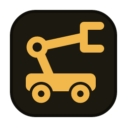
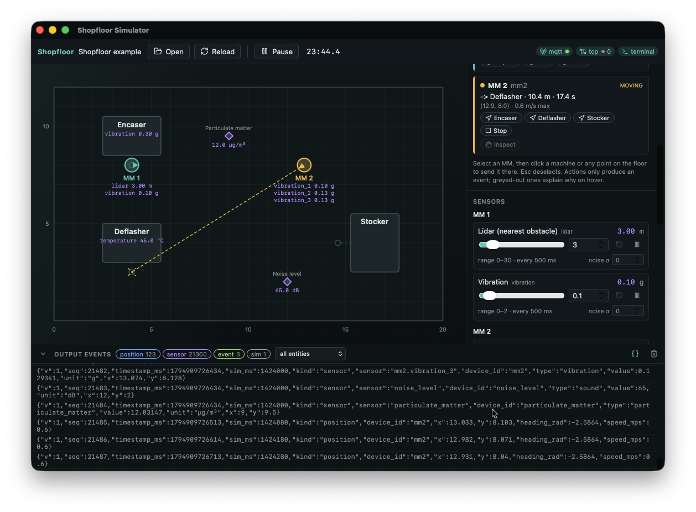

# Shopfloor Simulator

A desktop app and command-line tool that simulate a shop floor and stream everything that happens on it as JSON
events. Use it to feed a stream processor, or to record data, without a real floor.



<!-- ## Features -->

- **A configurable floor described in a TOML file:** **machines** that stay in place, **mobile manipulators (MMs)** that drive
  between them, and **sensors** mounted on either or standing on their own.
- **Manual control in the app:** send MMs to machines or to any point, have them perform actions such as pick and
  place, and change what each sensor reports while the simulation runs.
- **Scenes** script all of that (MMs shuttling between machines, actions, sensor faults) and play in the app or
  headless.
- **Headless runs** from the command line, in real time or as fast as possible (eg 10 minutes of data in under a second).
- **Outputs:** stdout, JSONL files, TCP to any program that connects, and MQTT topics with filters.
- **Trace replay:** play [Liminal Desk](https://github.com/duncanatt/liminal-desk-cli) traces on a floor's layout.

## Getting started

### Prerequisites

- [Rust](https://rustup.rs/) 1.90 or newer
- [Node.js](https://nodejs.org/) 22 with npm (for the GUI)
<!-- - Tauri 2's system dependencies for your OS: see [Tauri's prerequisites](https://v2.tauri.app/start/prerequisites/) -->

<!-- The command-line tool only needs Rust. -->

### Run the app

```bash
cd gui
npm install          # once
npm run tauri dev    # the app window, with Vite on 127.0.0.1:5174
```

The app opens [scenarios/sample-floor.toml](scenarios/sample-floor.toml). App logs go to stderr, and stdout carries
only event JSON lines (from a `stdout` output), so `npm run tauri dev 2>/dev/null | grep '^{' | jq .` shows the events.

### Command line

The `shopfloor` tool runs a scenario without the window. Events go to the scenario's outputs, and logs to stderr.

```bash
cargo run --bin shopfloor -- check scenarios/sample-floor.toml                         # validate + list contents
cargo run --bin shopfloor -- run scenarios/sample-floor.toml --scene production        # real time, until Ctrl+C
cargo run --bin shopfloor -- run scenarios/sample-floor.toml --scene vibration_fault   # ends when the scene ends
cargo run --bin shopfloor -- run scenarios/sample-floor.toml --scene production \
    --fast --duration 600 --jsonl recordings/production.jsonl           # 10 min of data in < 1 s
```

| Option | Meaning |
|---|---|
| `--scene ID` | Play this scene from the start. The run ends when the scene finishes (exit 0) or fails (exit 1). |
| `--duration SECS` | Stop after this much simulation time. Required with `--fast` for a looping scene. |
| `--fast` | Run as fast as possible. Events are still stamped as if in real time. TCP and MQTT outputs are skipped. |
| `--jsonl PATH` | Also write every event to this file (overwritten). |
| `--tcp ADDR` | Also stream every event over TCP on this address, e.g. `127.0.0.1:9000`. |

Without `--scene` or `--duration`, a real-time run continues until Ctrl+C. The binary is `target/debug/shopfloor`
(`cargo build --release --bin shopfloor` for an optimised one). `shopfloor replay` plays traces instead of simulating:
see [Replaying Liminal Desk traces](#replaying-liminal-desk-traces).

## Using the app

| Do | How |
|---|---|
| Select an MM | Click it on the floor or click its card on the right. Click again or press **Esc** to deselect. |
| Send it to a machine | With an MM selected, click the machine, or use the machine buttons on the MM's card. It drives to the machine's *dock* (the small circle). |
| Send it to a point | With an MM selected, click anywhere on the floor. A ghost circle shows where it will stop. |
| Re-target or stop | Give a new target while it moves, and the old move is replaced. **Stop** on its card stops it. |
| Perform an action | The action buttons (Pick, Place, …) on the MM's card. A greyed-out button says why on hover (e.g. "'pick' needs mm1 at a machine"). Dock and Undock, if the scenario defines them, also move the MM (see [Docking](#docking)). |
| Change a sensor | **Sensors** on the right: a slider or number field, a button to restore the default, **noise σ** for Gaussian noise, and a pause button that stops its readings, as if it had failed. Click a reading, or a free-standing sensor's diamond, on the floor to jump to its control. Free-standing sensors are under **Floor**. |
| Pause | **Pause** in the toolbar, or **Space**. |
| Play a scene | **Scenes** at the top right: **Play** / **Stop**. Each track shows what it waits on, and the toolbar shows the scene and its iteration. Pause applies to the scene too, and manual control still works. |
| Inspect the output | The bottom panel shows every event. Filter by entity, or by group: **position**, **sensor** (readings), **event** (moves, arrivals, stops and actions) and **sim** (the simulation, scenes and sensor changes). **{}** shows the raw JSON lines that the outputs write. |
| Start again, switch scenario | **Reload** re-reads the scenario file and starts again from time 0, and outputs reconnect. **Open** loads another scenario (the picker starts in `scenarios/`). |

## Scenario files

A scenario is a TOML file, in metres and seconds. The origin is the floor's bottom-left corner, with **y pointing
up**, and heading 0 is +x, counter-clockwise. **Unknown keys are errors**, and all errors are reported together.

[scenarios/small-floor.toml](scenarios/small-floor.toml) is a small example: two machines and one MM, with a sensor on
the oven and one on the MM.

```toml
name = "Small shop floor"

[floor]
width_m = 12.0
height_m = 8.0

# Two machines. An MM parks at a machine's dock: 0.5 m below it, unless `dock` says otherwise.
[machines.press]
position = [3.0, 6.0]
size = [2.0, 1.5]

[machines.oven]
position = [9.0, 6.0]
size = [2.0, 1.5]

[machines.oven.sensors.temperature]
unit = "°C"
default = 180.0
range = [0.0, 300.0]

# One mobile manipulator, starting at the press, with a sensor of its own.
[mobile_manipulators.mm1]
start_at = "press"

[mobile_manipulators.mm1.sensors.vibration]
unit = "g"
default = 0.2
range = [0.0, 5.0]

[actions.pick]
requires_machine = true

# Every event as a JSON line on stdout.
[output.sinks.terminal]
type = "stdout"
```

Open it in the app, or run it with `cargo run --bin shopfloor -- run scenarios/small-floor.toml`.

### Bundled scenarios

[sample-floor.toml](scenarios/sample-floor.toml) is the larger, commented example.

| Scenario | Setting | Floor | Scenes | Outputs |
|---|---|---|---|---|
| [basic.toml](scenarios/basic.toml) | The smallest useful floor: one MM, one machine, one sensor | 10×6 m | `visit_machine` | None |
| [small-floor.toml](scenarios/small-floor.toml) | The example above: two machines and one MM, two sensors | 12×8 m | None | stdout |
| [sample-floor.toml](scenarios/sample-floor.toml) | A factory cell: machines and mobile manipulators | 20×12 m | `production`, `vibration_fault`, `encaser_to_deflasher`, `sensor_dropout` | stdout, TCP, MQTT |
| [data-centre.toml](scenarios/data-centre.toml) | Server racks, cooling units and service robots | 24×14 m | `routine_rounds`, `cooling_failure` | stdout, TCP |
| [container-port.toml](scenarios/container-port.toml) | A ship, quay cranes, a container yard and fast vehicles | 400×200 m | `container_flow`, `high_wind` | stdout, TCP |
| [replay-example/die-processing.toml](scenarios/replay-example/die-processing.toml) | A die-processing shopfloor (deflasher, encaser and bonder on the left, stocker on the right), with two traces to replay on it and the docking actions | 14×10 m | None (its traces, in a `[replay]` section) | stdout, TCP, MQTT (topics under `die-cell/`) |
| [proposed-liminal-scenarios.toml](scenarios/proposed-liminal-scenarios.toml) | A factory cell for Liminal's scenario examples: noise exposure, temperature limits, anomalies, a stocker's level, … | 20×12 m | `shift` (all of them, 2 min), `production`, `noisy_period`, `deflasher_heat_spike`, `hall_draft`, `vibration_anomaly`, `lost_part`, `stocker_full_empty` | MQTT (topics under `factory/`) |

The floor can be any size: machines and MMs are drawn to scale, and text and markers scale with the floor so they stay
readable. On a large floor, set `grid_m` and `dock_tolerance_m` to match.

### Reference

| Key | Default | Meaning |
|---|---|---|
| `name` | "Untitled scenario" | Shown in the UI and in `sim` events |
| `[sim] tick_ms` | 20 | Fixed engine step |
| `[sim] seed` | 42 | Noise RNG seed (runs are reproducible) |
| `[sim] dock_tolerance_m` | 0.3 | An MM this close to a dock counts as "at" that machine |
| `[sim] start_paused` | false | Open paused in the app: the clock waits at 0 until you press Resume (or Space). `shopfloor run` ignores it. |
| `[floor] width_m`, `height_m` | required | Floor size |
| `[floor] grid_m` | 1.0 | Grid spacing in the UI |
| `[machines.<id>] position`, `size` | required | Footprint centre `[x, y]` and `[w, h]` |
| `[machines.<id>] dock` | 0.5 m below the footprint | Where MMs park to service the machine |
| `[machines.<id>] label` | id | Display name |
| `[mobile_manipulators.<id>] start` *or* `start_at` | one required | `[x, y]`, or a machine id to start docked there |
| `... start_heading_deg` | 0 | Initial heading |
| `... max_speed_mps` | 0.5 | Driving speed (constant) |
| `... radius_m` | 0.35 | Footprint. The MM's centre stays this far from the walls. |
| `... actions` | all of `[actions]` | Ids of the actions this MM can perform |
| `[actions.<id>]` | | An action MMs can perform. It is silent and only emits an `action` event. `dock` and `undock` are built in (see [Docking](#docking)). |
| `... label` | `<id>` humanised | Button label |
| `... requires_machine` | false | Only at a machine (within `dock_tolerance_m` of its dock) |
| `... allowed_while_moving` | false | Otherwise the MM must be stopped |
| `[<machines\|mobile_manipulators>.<id>.sensors.<name>]` | | A sensor mounted on that entity. Its id is `<id>.<name>`. |
| `[sensors.<id>]` + `position = [x, y]` | | A free-standing sensor at a fixed spot. It is its own entity (`device_id` = `<id>`) and takes the same keys as below. |
| `... default`, `range` | required | Initial value and `[min, max]`. Readings are clamped to the range. |
| `... kind` | `<name>` | Sensor type, e.g. `vibration`, `lidar` |
| `... unit` | "" | Unit string |
| `... label` | `<name>` humanised (`hall_temp` -> "Hall temp") | Display name |
| `... period_ms` | 1000 | Reporting period |
| `... noise_std` | 0 | Gaussian noise σ |
| `[scenes.<id>]` | | A scripted run (see [Scenes](#scenes)) |
| `... label` | `<id>` | Display name |
| `... loop` / `... repeat` | run once | `loop = true` repeats until stopped; `repeat = N` runs N iterations |
| `[[scenes.<id>.tracks]]` `name`, `steps` | name: "track N" | A track: a list of steps run in order. A scene's tracks run in parallel. |
| `[output] position_interval_ms` | 100 | How often a moving MM reports its position |
| `[output.sinks.<name>] type = "stdout"` | | One JSON line per event on stdout |
| `[output.sinks.<name>] type = "jsonl", path, append = true` | | One JSON line per event in a file. The path is relative to the scenario file. |
| `[output.sinks.<name>] type = "tcp", bind` | | Listen on `bind` (e.g. `127.0.0.1:9000`) and stream every event to each connected client (see [TCP](#tcp)) |
| `[output.sinks.<name>] type = "mqtt", broker` | | Publish each event to the topics it matches, on the broker at `broker` (`host:port` or `mqtt://host:port`; port 1883 by default). See [MQTT](#mqtt). |
| `... qos`, `client_id` | 0, `shopfloor-<name>-<process id>` | MQTT quality of service (0, 1 or 2) and client id |
| `[[output.sinks.<name>.topics]]` `topic`, `kinds`, `entities` | filters: everything | A topic and the events it carries: those whose `kind` is in `kinds` and whose `device_id` is in `entities`. At least one topic is required. |

Rules worth knowing:
- Entity ids use letters, digits, `_` and `-`.
- Machines, MMs and free-standing sensors share one id namespace.
- An action can't be called `move`, the `event` of move commands.
- Footprints, docks, starts and sensor positions must lie inside the floor.
- Only free-standing sensors have a `position`. A mounted sensor is where its host is.
- Periods must be at least `tick_ms`.

### Docking

A move to a machine drives the MM onto its dock. A scenario can also define two built-in actions, which take only a
`label`:

```toml
[actions.dock]
label = "Dock"

[actions.undock]
```

| Action | When | What it does |
|---|---|---|
| `dock` | The MM is stopped within 1 m of a machine's dock (or `dock_tolerance_m`, if larger) | Drives it onto that dock at its speed. Already on it: just the event. |
| `undock` | The MM is stopped at a machine's dock | Drives it 1 m out, away from the machine and leaning to one side (alternating by MM), as in a replay |

Both emit an `action` event (`event` `"dock"` / `"undock"`, `at` the machine). Until the MM gets there it counts as
moving: `wait_idle` waits for it, a stop leaves it where it is, and a new move replaces it. Moves themselves emit no
docking events, so a scene that wants a stream like the Liminal Desk traces performs them: move, `dock`, `pick`,
`undock`, move.

## Scenes

A scene scripts a run. It has one or more **tracks** that run in parallel, and each track is a list of **steps** run
in order:

```toml
[scenes.production]
label = "Production loop"
loop = true

[[scenes.production.tracks]]
name = "mm1 shuttle"
steps = [
  { move_to = { mm = "mm1", machine = "machine2" } },
  { wait_idle = "mm1" },
  { perform = { mm = "mm1", action = "pick" } },
  { wait_ms = 1500 },
  { move_to = { mm = "mm1", machine = "machine1" } },
  { wait_idle = "mm1" },
]

[[scenes.production.tracks]]
name = "mm1 vibration"
steps = [
  { wait_ms = 15000 },
  { set_sensor = { sensor = "mm1.vibration", value = 1.2 } },
  { wait_ms = 8000 },
  { set_sensor = { sensor = "mm1.vibration", value = 0.1 } },
]
```

| Step | Does |
|---|---|
| `move_to = { mm, machine }` or `{ mm, point = [x, y] }` | Send the MM somewhere (it does not wait for arrival) |
| `wait_idle = "mm1"` | Wait until the MM has no move in progress (it arrived, or was stopped) |
| `wait_ms = N` | Wait N ms of simulation time |
| `perform = { mm, action }` or `{ mm, action, object }` | Perform an action. The optional `object` (e.g. `"dies"`) is reported in the `action` event. |
| `set_sensor = { sensor, value }` | Set a sensor's value |
| `set_sensor_noise = { sensor, std }` | Set a sensor's noise |
| `pause_sensor = "mm1.vibration"` | Stop a sensor's readings, as if it had failed. It stays paused until resumed or the scenario is reloaded, even if the scene ends or is stopped. |
| `resume_sensor = "mm1.vibration"` | Start its readings again, on its usual schedule |
| `stop = "mm1"` | Stop the MM |

How it plays:
- Steps run in **simulation time**. Commands run as soon as their track reaches them, and a track only pauses at a
  wait. Pausing the simulation pauses the scene, and reloading stops it.
- An **iteration** ends when every track has finished. With `loop` / `repeat`, the tracks then start again from where
  the world is now. The world isn't reset, so a looping scene should return MMs to where they began.
- If a step is rejected, such as a `pick` while the MM isn't at a machine, the scene **fails** and stops. The world
  keeps running.
- References are checked when the scenario loads: unknown MMs, machines, sensors or actions, values out of range, and
  a loop without any wait.
- Playing a scene replaces the one playing. Manual commands still work during a scene.
- Every command a scene runs appears as its usual event with `origin: "scene"`, so a stream records who did what.

## Outputs

Events go to the app's log and to the scenario's outputs, `[output.sinks.<name>]`: stdout and JSONL files (see the
[reference](#reference)), and TCP and MQTT, below. The toolbar shows each output, and the TCP and MQTT ones get a green
dot while connected.

### TCP

A `tcp` output listens on its `bind` address, and any program can connect to it as a client to receive every event.
The sample, data-centre and container-port scenarios listen on `127.0.0.1:9000`, and the CLI's `--tcp ADDR` adds an
output to any scenario.

- **Framing:** each event is a 4-byte big-endian length followed by its JSON. A batch goes out in a single write, so
  frames arrive whole.
- **Either side can start first.** Any number of clients can connect, and ones that disconnect are dropped. Events
  aren't kept, so a client only sees what happens after it connects.
- **Status:** the toolbar's `tcp` badge shows the client count. The CLI logs connects and disconnects.
- **One process per port:** the app and a real-time CLI run of the same scenario can't both listen; the second fails
  with "Failed to listen on 127.0.0.1:9000". Change `bind` (or use `--tcp`) to run both.

For a stream processor consuming it, see [Example: Liminal](#example-liminal).

### MQTT

An `mqtt` output publishes events to a broker, such as [Mosquitto](https://mosquitto.org/), on topics you define. Each
topic says which events it carries, so a subscriber takes only the part of the stream it needs:

```toml
[output.sinks.mqtt]
type = "mqtt"
broker = "127.0.0.1:1883"

# Sensor readings, and nothing else (`kinds` can list several, e.g. ["sensor", "sensor_set"]).
[[output.sinks.mqtt.topics]]
topic = "shopfloor/sensors"
kinds = ["sensor"]

# Everything about mm1.
[[output.sinks.mqtt.topics]]
topic = "shopfloor/mm1"
entities = ["mm1"]

# Every event.
[[output.sinks.mqtt.topics]]
topic = "shopfloor/all"
```

- **Routing:** an event goes to every topic it matches: its `kind` is in `kinds` and its `device_id` is in
  `entities`, and a missing filter matches everything. `sim` and `scene` events have no `device_id`, so they only go
  to topics without `entities`. Unknown kinds and entities are errors when the scenario loads, as are wildcards (`+`,
  `#`) in a topic name.
- **Payload:** each message is one event, the same JSON line the other outputs write. Messages are not retained.
- **Either side can start first.** The simulator retries every second until the broker is up, and logs only the
  first failure. Events from while the broker is unreachable are dropped, except those from before the first
  connection attempt finishes, so a run started with the broker up delivers everything from `sim` `started`.
- **Status:** the toolbar's `mqtt` badge tooltip lists the topics and their filters. The CLI logs connects and lost
  connections.
- **Several processes per broker:** the app and a CLI run can publish to the same broker at once, since each has its
  own client id.

To try it with the sample scenario's MQTT output:

```bash
docker run -it -p 1883:1883 eclipse-mosquitto        # terminal 1: a Mosquitto broker on localhost:1883
cargo run --bin shopfloor -- run scenarios/sample-floor.toml --scene production   # terminal 2
```
<!-- docker run -d -p 1883:1883 --name mosquitto eclipse-mosquitto -->

Then subscribe to a topic, such as `shopfloor/sensors`, on `localhost:1883` with any MQTT client: Postman, or
`mosquitto_sub -t shopfloor/sensors -v` if Mosquitto is installed.

## Event format

Every event is **one flat JSON object** with the same envelope:

| Field | Meaning |
|---|---|
| `v` | Schema version, currently `1` |
| `seq` | Sequence number, +1 per event. It restarts when a scenario is loaded. |
| `timestamp_ms` | Wall-clock time, epoch **milliseconds** (integer) |
| `sim_ms` | Simulation time in ms, excluding pauses |
| `kind` | One of the kinds below |

| `kind` | When | Fields |
|---|---|---|
| `position` | Every `position_interval_ms` while an MM moves, plus once on arrival (with `speed_mps` 0). **Not emitted while idle.** | `device_id`, `x`, `y`, `heading_rad`, `speed_mps` |
| `move_command` | An MM gets a target | `device_id`, `event` (`"move"`), `source`, `destination` (machine ids or null), `command_id`, `origin`, `from {x,y}`, `to {x,y}`, `distance_m`, `eta_ms`, `replaces` (previous `command_id` or null) |
| `arrived` | An MM reaches its target | `device_id`, `command_id`, `x`, `y`, `at` |
| `stopped` | An MM is stopped before arriving | `device_id`, `command_id`, `x`, `y`, `at`, `origin` |
| `sensor` | Every `period_ms` per sensor | `sensor_id`, `device_id` (host, or the sensor itself if free-standing), `type` (the sensor's kind), `value`, `unit`, `x`, `y` (where the reading was taken: the MM's current position, the machine's centre, or the fixed position) |
| `sensor_set` | A sensor's setpoint, noise or pause state is changed | `sensor_id`, `device_id`, `type`, `setpoint`, `noise_std`, `previous_setpoint`, `paused`, `origin` |
| `action` | An MM performs an action (silent: nothing else changes, except that `dock` and `undock` move it, see [Docking](#docking)) | `device_id`, `event` (the action's id, e.g. `"pick"`), `object` (from the `perform` step, else null), `command_id` (shared with moves), `x`, `y`, `at`, `origin` |
| `sim` | Started, paused, resumed or reset | `state`, `scenario` |
| `scene` | A scene starts, restarts (next iteration), finishes, is stopped, or fails | `scene`, `state` (`started`/`restarted`/`finished`/`stopped`/`failed`), `iteration`, `error` (why it failed, else null) |

`at`, `source` and `destination` are the machine id when the point is within `dock_tolerance_m` of that machine's
dock, otherwise `null`. So "mm1 moves from machine1 to machine2, then picks there" is:

```json
{"v":1,"seq":41,"timestamp_ms":1761730004200,"sim_ms":4200,"kind":"move_command","device_id":"mm1","event":"move","source":"machine1","destination":"machine2","command_id":3,"origin":"ui","from":{"x":4.0,"y":8.0},"to":{"x":10.0,"y":8.0},"distance_m":6.0,"eta_ms":7500,"replaces":null}
{"v":1,"seq":42,"timestamp_ms":1761730004300,"sim_ms":4300,"kind":"position","device_id":"mm1","x":4.08,"y":8.0,"heading_rad":0.0,"speed_mps":0.8}
{"v":1,"seq":43,"timestamp_ms":1761730004500,"sim_ms":4500,"kind":"sensor","sensor_id":"mm1.vibration","device_id":"mm1","type":"vibration","value":1.0,"unit":"g","x":4.4,"y":8.0}
{"v":1,"seq":57,"timestamp_ms":1761730011700,"sim_ms":11700,"kind":"arrived","device_id":"mm1","command_id":3,"x":10.0,"y":8.0,"at":"machine2"}
{"v":1,"seq":88,"timestamp_ms":1761730012300,"sim_ms":12300,"kind":"action","device_id":"mm1","event":"pick","object":"dies","command_id":7,"x":10.0,"y":8.0,"at":"machine2","origin":"ui"}
```

The keys follow the [Liminal Desk](https://github.com/duncanatt/liminal-desk-cli) traces wherever they describe the
same thing (`device_id`, `event`, `type`, `target`, `object`, `source`, `destination`, `timestamp_ms`). Every key of a
trace payload is in the matching event, so a rule written for a trace also works on the simulator's stream; the one
exception is lidar's `target`. The exact strings are pinned in [core/src/event.rs](core/src/event.rs).

**Schema version:** adding a kind or a field keeps `v`, so consumers should ignore what they don't know. Renaming,
removing or retyping a field bumps it.

Notes for consumers:
- Route on the top-level fields, starting with `kind`. No field is nested deeper than `from` / `to`.
- Measurements (`x`, `y`, `value`, …) are always JSON floats, even when whole (`1.0`), so compare numbers with `>`,
  `<`, `>=`, `<=` rather than strict equality.
- `timestamp_ms` can be used directly as the event time.
- `sensor_set`, `move_command` and `action` are ground truth: what the operator (or a script) did and when. That's
  useful for labelling, and it means a recording contains its own script.

## Replaying Liminal Desk traces

[Liminal Desk](https://github.com/duncanatt/liminal-desk-cli) traces are JSON files of `send` and `delay` steps. The
simulator can play them on a scenario's layout instead of simulating: each payload goes to the scenario's outputs at
the time the delays give, exactly as written in the trace. Nothing else is sent: no physics, no periodic sensor
readings and, unless you ask, no position reports.

```bash
cargo run --bin shopfloor -- replay scenarios/replay-example/die-processing.toml   # its [replay] traces, real time
cargo run --bin shopfloor -- replay scenarios/replay-example/die-processing.toml \
  scenarios/replay-example/machine_events.json scenarios/replay-example/sensor_events.json \
  --format envelope --positions --fast --jsonl recordings/replay.jsonl          # given traces, all at once, to a file
cargo run --bin shopfloor -- check scenarios/replay-example/die-processing.toml    # check its traces, no replay
```

The scenario provides the layout and the outputs, and it can name its traces in a `[replay]` section, as
[scenarios/replay-example/](scenarios/replay-example/) does. These are what `shopfloor replay` plays when given no
trace files, and what the app's Replay section starts with. Until a replay starts, the scenario simulates as usual.

```toml
[replay]
traces = ["machine_events.json", "sensor_events.json"]   # relative to this file
format = "payload"     # or "envelope"
positions = false
```

| Option | Meaning |
|---|---|
| `TRACE...` | Trace files to play side by side. They replace the scenario's `[replay] traces`. |
| `--format payload` | The default: each payload as written in the trace (same keys, order and number literals), on one line. |
| `--format envelope` | The payload with `"v":1,"seq":N,"sim_ms":T,"kind":K` in front, plus `timestamp_ms` if it has none. |
| `--positions` / `--no-positions` | Also report the positions of moving MMs, every `position_interval_ms`. Off by default. |
| `--fast`, `--jsonl PATH`, `--tcp ADDR` | As for `run`. |

How a replay works:
- **Timing:** each trace's steps happen when its delays say. Several traces are merged on their delays, and ties go in
  the order the traces were given. The payloads' own `timestamp_ms` values are sent unchanged (liminal-desk-cli
  refreshes them as it sends).
- **Routing:** a payload counts as a simulator event kind: `event: "move"` is a `move_command`, any other `event`
  (`pick`, `place`, `dock`, `undock`, …) is an `action`, and a `type` without an `event` is a `sensor`. Its
  `device_id` is its device. MQTT topics filter on these two, without anything being added to the payload.
- **The picture:** an `undock` glides the MM out over a second to a point 1 m from the dock (leaning to one side,
  alternating by MM, so two MMs at one machine stand apart), a `move` drives it to the destination's approach point by
  its next event, and a `dock` glides it in. Other events flash their name above the MM. Sensor payloads update the
  sensor with the same `device_id` (its host) and `type` (its kind).
- **Read-only:** no moves, actions, sensor changes or scenes; the app disables them and the backend refuses them.
  Pause works. To start over, stop the replay and start it again.
- **Position reports** (`--positions`) are sampled from those movements. In the payload format they are
  `{"device_id","x","y","heading_rad","speed_mps","timestamp_ms"}`; in the envelope format, the simulator's own
  `position` event.

In the app, the **Replay** section at the top of the right-hand panel is open when the scenario has a `[replay]`
section:
- **Traces** lists the files to play: **Add…** adds some, **×** removes one, and the order breaks ties. Changes
  aren't written back to the scenario file.
- **Output** switches between `payload` and `envelope`, and **Positions** turns position reports on.
- **Start replay** shows progress (time, payloads sent). **Stop replay**, or the last payload going out, goes back to
  simulating the same layout, keeping the traces and options for another run.
- The outputs stay open throughout, so a TCP client such as Liminal stays connected. **Open** and **Reload** restart
  them.

Checks:
- **Errors stop a replay.**
  - A trace must be exactly `{"version": 1, "steps": [...]}` with at least one step, and each step exactly
    `{"type": "send", "payload": ...}` or `{"type": "delay", "duration_ms": N}` with N a non-negative integer. These
    errors name the file, the step and its line.
  - Everything a trace uses must be defined in the scenario: each payload is a JSON object with a `device_id` that is
    a machine, an MM or a sensor; each `event` other than `move` is one of the scenario's actions (so `dock` and
    `undock` need `[actions.dock]` / `[actions.undock]`); each `target`, `source` and `destination` is a machine; and
    each reading's `device_id` + `type` is one of its sensors (on an MM, on a machine, or free-standing). Every problem
    is listed together, with its file and step.
- **Warnings** concern timing and order, and the replay still runs: a `timestamp_ms` that disagrees with the delays,
  traces that start at different times, events that don't follow on (such as a dock at a machine other than the
  move's destination). They're printed before a replay and shown in the app. Units aren't compared.

## Example: Liminal

[Liminal](https://github.com/gertab/liminal) is a stream processor configured in TOML. It can consume the simulator's
[TCP](#tcp) stream with its `tcp_input` in client mode, pointed at the output's `bind` address:

```toml
[inputs.shopfloor]
type = "tcp_input"
output = "shopfloor_events"
channel = { type = "broadcast", capacity = 1024 }
parameters = { mode = "client", host = "127.0.0.1", port = 9000, reconnect = true, reconnect_interval_ms = 1000 }
```

With an [MQTT](#mqtt) output, Liminal's `mqtt_sub` can instead subscribe to only the topics a pipeline needs. It
parses each payload as JSON:

```toml
[inputs.sensors]
type = "mqtt_sub"
output = "sensor_events"
channel = { type = "broadcast", capacity = 1024 }
parameters = { broker_url = "mqtt://127.0.0.1:1883", topics = ["shopfloor/sensors"] }
```

Writing a pipeline:
- `tcp_input` makes each whole frame the message payload and keeps no topic, so route on the event's fields, for
  example a `rule` with `condition = { field_path = "kind", operation = "equals", value = "sensor" }`.
- Liminal's `equals` is strict (`1` ≠ `1.0`), and measurements are floats, so compare numbers with `>`, `<`, `>=`, `<=`.
- Use `timestamp_ms` as the event time: `timing.event_time_field = "timestamp_ms"`.
- Route actions on `event`, e.g. `event` equals `"pick"`. No action can be called `move`, so this matches only actions.

How it behaves:
- Liminal reconnects every second until the simulator is listening. It logs each failed attempt as an error, which is
  harmless.
- `tcp_input` can lose its place in the stream if a frame is ever split across its 100 ms read timeout. That's rare on
  localhost, since the simulator writes each batch whole. If it happens, Liminal logs a parse error, or drops the
  connection and reconnects.

## Development

```bash
cargo fmt --all             # formatting (rustfmt.toml)
cargo test --workspace      # engine, scenes, scenario validation, golden event JSON, runtime, headless runs
cargo clippy --workspace --all-targets
cd gui && npm run build     # TypeScript type-check + production bundle
```

- The Tauri crate needs `gui/dist` to compile, so on a fresh checkout run `npm install` and `npm run build` in `gui/`
  before the cargo commands.
- `cargo test` also regenerates the app's TypeScript types in `gui/src/bindings/` from the Rust ones, so commit them
  with the Rust change that caused them.
- CI ([.github/workflows/ci.yml](.github/workflows/ci.yml)) runs all of the above on every push and pull request, and
  fails if the bindings are out of date.

### Architecture

```text
shopfloor-sim/
  core/              shopfloor-core (pure Rust, no Tauri)
    src/lib.rs         the library: engine, scenes, scenarios, replay, runtime, sinks. Each module has its tests.
    src/main.rs        the headless `shopfloor` command (cargo feature `cli`, on by default)
  gui/               the desktop app (npm project)
    src/               React UI: draws state, sends commands
    src/bindings/      the Rust types it receives, generated by `cargo test` (ts-rs)
    src-tauri/         shopfloor-gui: thin Tauri shell (commands + event bridge)
  scenarios/         the bundled scenario files
```

<!-- ```
React UI ── invoke("send_command", {move_to ...}) ──► SimRuntime (tokio task owning the Engine)
   ▲                                                   │  ticks every sim.tick_ms
   │  "shopfloor://state"  (~30 Hz, WorldState)  ◄─────┤  watch channel
   │  "shopfloor://events" (every 100 ms, batch)  ◄────┤  broadcast channel ──► sinks (stdout, jsonl; own threads)
``` -->

- **`Engine`** ([core/src/engine.rs](core/src/engine.rs)) is synchronous and deterministic. It changes only through
  `apply(command)` and `step()` (one fixed tick of sim time), and both return the events they caused. Wall-clock time
  is passed in only to stamp events, so runs are reproducible and can go faster than real time.
- **Commands** ([core/src/command.rs](core/src/command.rs)) are the only way in: `move_to`, `stop`, `perform`,
  `set_sensor`, `set_sensor_noise` and `set_sensor_paused`. Each carries an origin (`ui`, `scene` or `api`): the UI
  is just one command source.
- **Action rules** live in `Engine::action_blocker`. It rejects a `perform` that isn't allowed and fills
  `MmView.actions` (available + reason), so the UI never re-implements the rules.
- **Scenes** ([core/src/scene.rs](core/src/scene.rs)) are played by the engine after each tick's physics
  ([core/src/engine/scenes.rs](core/src/engine/scenes.rs)). Their commands go through `apply` with `origin: "scene"`,
  and waits are in sim time, so a scene pauses and runs fast together with the world, deterministically.
- **Path planning** sits behind `trait PathPlanner` ([core/src/motion.rs](core/src/motion.rs)). The default,
  `StraightLine`, ignores obstacles.
- **Scenario files** ([core/src/scenario/](core/src/scenario/)): `spec.rs` is the TOML schema, `resolve.rs` checks it
  section by section and reports every problem together, and `outputs.rs` covers `[output]`.
- **Runtimes** ([core/src/runtime/](core/src/runtime/)): one `Runtime` plays a `Driver` in real time and fans out its
  output. The engine and a trace replay are both drivers, so `SimRuntime` and `ReplayRuntime` are the same code.
  Loading a scenario starts a fresh runtime. `--fast` runs use `headless::drive`
  ([core/src/headless.rs](core/src/headless.rs)) instead, which steps any driver in a loop and writes straight to the
  sinks.
- **Sinks** ([core/src/sinks/](core/src/sinks/)) each run on their own thread. A slow sink skips batches with a warning
  instead of slowing the simulation. Sinks take `Message`s: JSON plus the `kind` and `device_id` that MQTT topics
  route on, so a replayed payload reaches the same sinks as an event.
- **Trace replay** ([core/src/replay/](core/src/replay/)) takes the engine's place. A `Replay` plays traces parsed by
  [core/src/trace.rs](core/src/trace.rs), `checks.rs` checks them against the scenario, and `track.rs` works out where
  each MM is. It takes no commands, only pause, resume and reset.

### Extending

After a change to a type the app receives, run `cargo test` to regenerate its TypeScript types.

- **New MM action** (e.g. `weld`): no code needed. Add `[actions.weld]` to the scenario, and optionally list it in an
  MM's `actions`.
- **New sink** (e.g. a WebSocket): add a `SinkKind` variant in
  [core/src/scenario/outputs.rs](core/src/scenario/outputs.rs), implement `EventSink` in `core/src/sinks/`, construct
  it in `build_sink`, and give it an icon in the toolbar.
- **New command:** add a `SimCommand` variant and handle it in `Engine::apply`, emitting an event if it changes the
  world.
- **New event kind:** add an `EventBody` variant with a golden test, and its kind to `EVENT_KINDS`
  ([core/src/event.rs](core/src/event.rs)). The frontend build then fails until the kind has a label and a log group
  (`KIND_LABELS`, `KIND_GROUP` in [gui/src/format.ts](gui/src/format.ts)); give it a summary line in `describeEntry`
  there too.
- **New scene step:** add a `StepSpec` variant and resolve it in `resolve_step` ([core/src/scene.rs](core/src/scene.rs)).
  A new kind of wait also needs a `Wait` variant, checked in `Engine::run_scene`
  ([core/src/engine/scenes.rs](core/src/engine/scenes.rs)).
- **Obstacle avoidance:** implement `PathPlanner` and pass it with `Engine::with_planner`.
- **Another trace format:** parse it into `trace::Trace` (sends and delays). The replay, checks and animation then
  work as they are.

## Todos

- Richer scenes: steps triggered by other events, sensor ramps, labelled markers, random variation.
- An obstacle-avoiding planner.
- Lidar computed from the layout.
- In-app layout editing.
- MQTT over TLS, and broker usernames and passwords.
