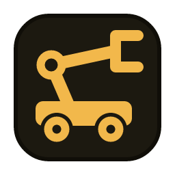

# Shopfloor Simulator

An interactive shopfloor simulator: a desktop app and a command-line tool that produce a stream of events from a
simulated floor.

A rectangle of floor holds fixed **machines** and **mobile manipulators (MMs)**. Both can carry **sensors**, and
sensors can also stand on their own at a fixed spot.
- You send MMs to machines or to any point on the floor.
- MMs perform **actions** such as pick and place. These are *silent*: they only produce an event.
- You change what each sensor reports while the simulation runs.
- **Scenes** script all of the above: MMs shuttling between machines, actions, sensor faults. They play in the app
  or headless from the command line, so the stream can be produced without anyone clicking.
- Everything that happens is emitted as a stream of JSON events: positions, move commands, actions and sensor readings.

Events go to the in-app log and, depending on the scenario's outputs, to stdout, JSONL files, and **over TCP** to any
program that connects, such as a stream processor (see [Streaming over TCP](#streaming-over-tcp)). It was built to feed
[Liminal](#example-liminal), but has no dependency on it.

## Run it

```bash
cd gui
npm install                 # once
npm run tauri dev           # Vite on 127.0.0.1:5174 + the app window
```

- The app's npm project is `gui/`, so run `npm` commands there.
- The app opens [scenarios/sample-floor.toml](scenarios/sample-floor.toml). Scenario files live in `scenarios/`.
- It uses port **5174**, so it can run at the same time as an app on Vite's default port (5173), such as the Liminal
  GUI.
- App logs go to **stderr**.
- **stdout** carries only event JSON lines (when the `stdout` sink is enabled). For example:
  `npm run tauri dev 2>/dev/null | grep '^{' | jq .`

### Headless (no window)

The `shopfloor` command-line tool runs a scenario, and optionally one of its scenes, without the GUI. Events go to the
scenario's `[output.sinks]`, and logs go to stderr.

```bash
cargo run --bin shopfloor -- check scenarios/sample-floor.toml                         # validate + list contents
cargo run --bin shopfloor -- run scenarios/sample-floor.toml --scene production        # real time, until Ctrl+C
cargo run --bin shopfloor -- run scenarios/sample-floor.toml --scene vibration_fault   # ends when the scene ends
cargo run --bin shopfloor -- run scenarios/sample-floor.toml --scene production \
    --fast --duration 600 --jsonl recordings/production.jsonl           # 10 min of data in < 1 s
```

| Option | Meaning |
|---|---|
| `--scene ID` | Play this scene from the start. The run ends when the scene finishes (exit 0) or fails (exit 1). |
| `--duration SECS` | Stop after this much simulation time. Required with `--fast` for a looping scene. |
| `--fast` | Run as fast as possible. Events are still stamped as if the run happened in real time. |
| `--jsonl PATH` | Also write every event to this file (overwritten). |
| `--tcp ADDR` | Also stream every event over TCP on this address, e.g. `127.0.0.1:9000`. TCP outputs are skipped with `--fast`. |

Without `--scene` or `--duration`, a real-time run continues until Ctrl+C. The binary itself is
`target/debug/shopfloor` (or `cargo build --release --bin shopfloor`).

### Tests and checks

```bash
cargo test --workspace      # engine, scenes, scenario validation, golden event JSON, runtime, headless runs
cargo clippy --workspace --all-targets
cd gui && npm run build     # TypeScript type-check + production bundle
```

## Using the app

| Do | How |
|---|---|
| Select an MM | Click it on the floor or click its card on the right. Click again or press **Esc** to deselect. |
| Send it to a machine | With an MM selected, click the machine. Or use the **Go to** buttons on the MM's card. The MM drives to the machine's *dock* (the small circle). |
| Send it to a point | With an MM selected, click anywhere on the floor. A ghost circle shows where it will stop. |
| Re-target | Give a new target while it moves. The old move is replaced immediately. |
| Stop | **Stop** on the MM's card. |
| Perform an action | Use the action buttons (Pick, Place, ...) on the MM's card. A greyed-out button shows why on hover (e.g. "'pick' needs mm1 at a machine"). The action name flashes above the MM, and the card shows the last action. |
| Change a sensor | Use the slider or number field in **Sensors** on the right. The reset button beside it restores the default. The pause button stops its readings, as if the sensor had failed, until you resume it. **noise σ** adds Gaussian noise. Clicking a reading or a free-standing sensor's diamond on the floor jumps to its control. Free-standing sensors are listed under **Floor**. |
| Pause / reset | Toolbar, or **Space** to pause and resume. Reset returns to start positions, default sensor values and time 0. |
| Inspect the output | The bottom panel shows every event. You can filter by kind or entity. **{}** shows the raw JSON lines that the sinks write. |
| Play a scene | **Scenes** at the top right: **Play** / **Stop**. While it plays, each track shows what it waits on, and the toolbar shows the scene and its iteration. Pause and Reset apply to the scene too, and manual control still works. |
| Switch scenario | **Open** (the picker starts in `scenarios/`). **Reload** re-reads the current file. |

## Architecture

```
shopfloor-sim/
  core/              shopfloor-core (pure Rust, no Tauri)
    src/lib.rs         the engine. Tests live here.
    src/main.rs        the headless `shopfloor` command (cargo feature `cli`, on by default)
  gui/               the desktop app (npm project)
    src/               React UI: draws state, sends commands
    src-tauri/         shopfloor-gui: thin Tauri shell (commands + event bridge)
  scenarios/         the bundled scenario files
  docs/              design notes (local, git-ignored)
```

```
React UI ── invoke("send_command", {move_to ...}) ──► SimRuntime (tokio task owning the Engine)
   ▲                                                   │  ticks every sim.tick_ms
   │  "shopfloor://state"  (~30 Hz, WorldState)  ◄─────┤  watch channel
   │  "shopfloor://events" (every 100 ms, batch)  ◄────┤  broadcast channel ──► sinks (stdout, jsonl; own threads)
```

- **`Engine`** ([core/src/engine.rs](core/src/engine.rs)) is synchronous and deterministic.
  - It changes only through `apply(command)` and `step()`. One step is one fixed tick of sim time.
  - Both return the events they caused.
  - Wall-clock time is passed in and used only to stamp events. Runs are therefore reproducible, and the engine can be
    stepped faster than real time.
- **Commands** ([core/src/command.rs](core/src/command.rs)) are the only way in: `move_to`, `stop`, `perform`,
  `set_sensor`, `set_sensor_noise` and `set_sensor_paused`.
  - Each one carries an origin: `ui`, `scene` or `api`.
  - The UI is just one command source. Scripted scenes or external tools can send the same commands.
- **Action rules** live in one place, `Engine::action_blocker`.
  - It rejects a `perform` command that isn't allowed.
  - It also fills `MmView.actions` (available + reason), so the UI never re-implements the rules.
- **Scenes** ([core/src/scene.rs](core/src/scene.rs)) are played by the engine itself, after each tick's physics.
  - Their commands go through `apply` with `origin: "scene"`.
  - Waits are measured in simulation time.
  - So a scene pauses, resets and runs fast together with the world, and is deterministic.
- **Path planning** sits behind `trait PathPlanner` ([core/src/motion.rs](core/src/motion.rs)). The default,
  `StraightLine`, ignores obstacles.
- **`SimRuntime`** ([core/src/runtime.rs](core/src/runtime.rs)) drives an engine in real time and fans out events.
  Loading a scenario starts a fresh runtime.
- **Sinks** ([core/src/sinks/](core/src/sinks/)) each run on their own thread. A slow sink skips batches with a warning
  instead of slowing the simulation.
- **Headless runs** use the same `SimRuntime` in real time. `--fast` runs use
  [core/src/headless.rs](core/src/headless.rs), which steps the engine in a loop and writes straight to the sinks.

## Scenario files

TOML, in metres and seconds.
- The origin is the bottom-left corner of the floor, with **y pointing up**.
- Heading 0 is +x, counter-clockwise.
- **Unknown keys are errors.** All validation errors are reported together.

See [scenarios/sample-floor.toml](scenarios/sample-floor.toml) for a commented example. All the bundled scenarios use
the same file format and the same simulator:

| Scenario | Setting | Floor | Scenes | Example Liminal config |
|---|---|---|---|---|
| [basic.toml](scenarios/basic.toml) | The smallest useful floor: one MM, one machine, one sensor | 10×6 m | `visit_machine` | None: it has no sinks |
| [sample-floor.toml](scenarios/sample-floor.toml) | A factory cell: machines and mobile manipulators | 20×12 m | `production`, `vibration_fault`, `encaser_to_deflasher`, `sensor_dropout` | `config_shopfloor_vibr_tcp.toml` |
| [data-centre.toml](scenarios/data-centre.toml) | Server racks, cooling units and service robots | 24×14 m | `routine_rounds`, `cooling_failure` | `config_shopfloor_datacentre_tcp.toml` |
| [container-port.toml](scenarios/container-port.toml) | A ship, quay cranes, a container yard and fast vehicles | 400×200 m | `container_flow`, `high_wind` | `config_container_port_tcp.toml` |

The Liminal configs are in Liminal's `config/examples/`, on its `shopfloor` branch (see
[Example: Liminal](#example-liminal)).

The floor can be any size. Machines and MMs are drawn at their real size, and text and markers scale with the floor so
they stay readable. On a large floor, set `grid_m` and `dock_tolerance_m` to match.

| Key | Default | Meaning |
|---|---|---|
| `name` | "Untitled scenario" | Shown in the UI and in `sim` events |
| `[sim] tick_ms` | 20 | Fixed engine step |
| `[sim] seed` | 42 | Noise RNG seed (runs are reproducible) |
| `[sim] dock_tolerance_m` | 0.3 | An MM this close to a dock counts as "at" that machine |
| `[floor] width_m`, `height_m` | required | Floor size |
| `[floor] grid_m` | 1.0 | Grid spacing in the UI |
| `[machines.<id>] position`, `size` | required | Footprint centre `[x, y]` and `[w, h]` |
| `[machines.<id>] dock` | 0.5 m below the footprint | Where MMs park to service the machine |
| `[machines.<id>] label` | id | Display name |
| `[mobile_manipulators.<id>] start` *or* `start_at` | one required | `[x, y]`, or a machine id to start docked there |
| `... start_heading_deg` | 0 | Initial heading |
| `... max_speed_mps` | 0.5 | Driving speed (constant) |
| `... radius_m` | 0.35 | Footprint. The MM's centre stays this far from the walls. |
| `... actions` | all of `[actions]` | Ids of the actions this MM can perform |
| `[actions.<id>]` | | An action MMs can perform. It is silent and only emits an `action` event. |
| `... label` | `<id>` humanised | Button label |
| `... requires_machine` | false | Only while docked at a machine (within `dock_tolerance_m` of its dock) |
| `... allowed_while_moving` | false | Otherwise the MM must be stopped |
| `[<machines\|mobile_manipulators>.<id>.sensors.<name>]` | | A sensor mounted on that entity. Its id is `<id>.<name>`. |
| `[sensors.<id>]` + `position = [x, y]` | | A free-standing sensor at a fixed spot. It is its own entity: `entity` = `<id>`. It takes the same keys as below. |
| `... default`, `range` | required | Initial value and `[min, max]`. Readings are clamped to the range. |
| `... kind` | `<name>` | Sensor type, e.g. `vibration`, `lidar` |
| `... unit` | "" | Unit string |
| `... label` | `<name>` humanised (`hall_temp` -> "Hall temp") | Display name |
| `... period_ms` | 1000 | Reporting period |
| `... noise_std` | 0 | Gaussian noise σ |
| `[scenes.<id>]` | | A scripted run (see [Scenes](#scenes)) |
| `... label` | `<id>` | Display name |
| `... loop` / `... repeat` | run once | `loop = true` repeats until stopped; `repeat = N` runs N iterations |
| `[[scenes.<id>.tracks]]` `name`, `steps` | name: "track N" | A track: a list of steps run in order. A scene's tracks run in parallel. |
| `[output] position_interval_ms` | 100 | How often a moving MM reports its position |
| `[output.sinks.<name>] type = "stdout"` | | One JSON line per event on stdout |
| `[output.sinks.<name>] type = "jsonl", path, append = true` | | One JSON line per event in a file. The path is relative to the scenario file. `recordings/` is git-ignored. |
| `[output.sinks.<name>] type = "tcp", bind` | | Listen on `bind` (e.g. `127.0.0.1:9000`) and stream every event to each connected client as a length-prefixed JSON frame (see [Streaming over TCP](#streaming-over-tcp)). |

Rules worth knowing:
- Entity ids use letters, digits, `_` and `-`.
- Machines, MMs and free-standing sensors share one id namespace.
- Footprints, docks, starts and sensor positions must lie inside the floor.
- Only free-standing sensors have a `position`. A mounted sensor is where its host is.
- Periods must be at least `tick_ms`.

## Scenes

A scene scripts a run. It has one or more **tracks** that run in parallel, and each track is a list of **steps** run
in order:

```toml
[scenes.production]
label = "Production loop"
loop = true

[[scenes.production.tracks]]
name = "mm1 shuttle"
steps = [
  { move_to = { mm = "mm1", machine = "machine2" } },
  { wait_idle = "mm1" },
  { perform = { mm = "mm1", action = "pick" } },
  { wait_ms = 1500 },
  { move_to = { mm = "mm1", machine = "machine1" } },
  { wait_idle = "mm1" },
]

[[scenes.production.tracks]]
name = "mm1 vibration"
steps = [
  { wait_ms = 15000 },
  { set_sensor = { sensor = "mm1.vibration", value = 1.2 } },
  { wait_ms = 8000 },
  { set_sensor = { sensor = "mm1.vibration", value = 0.1 } },
]
```

| Step | Does |
|---|---|
| `move_to = { mm, machine }` or `{ mm, point = [x, y] }` | Send the MM somewhere (it does not wait for arrival) |
| `wait_idle = "mm1"` | Wait until the MM has no move in progress (it arrived, or was stopped) |
| `wait_ms = N` | Wait N ms of simulation time |
| `perform = { mm, action }` | Perform an action |
| `set_sensor = { sensor, value }` | Set a sensor's value |
| `set_sensor_noise = { sensor, std }` | Set a sensor's noise |
| `pause_sensor = "mm1.vibration"` | Stop a sensor's readings, as if it had failed. It stays paused until resumed or the simulation is reset, even if the scene ends or is stopped. |
| `resume_sensor = "mm1.vibration"` | Start its readings again, on its usual schedule |
| `stop = "mm1"` | Stop the MM |

How it plays:
- Steps run in **simulation time**.
  - Commands run the moment their track reaches them.
  - A track only pauses at a wait.
  - Pausing the simulation pauses the scene; Reset stops it.
- An **iteration** ends when every track has finished. With `loop` / `repeat`, all tracks then start again from where
  the world is now. The world is not reset, so write looping scenes that return MMs to where they began.
- If a step is rejected, the scene **fails** and stops, and the world keeps running. Example: a `pick` while the MM
  isn't at a machine.
- References are checked when the scenario loads: unknown MMs, machines, sensors or actions, values out of range, and
  a loop without any wait.
- Playing a scene while another plays replaces it. Manual commands still work during a scene.
- Every command a scene runs appears as its usual event with `origin: "scene"`, so a stream records who did what.

## Streaming over TCP

The sample, data-centre and container-port scenarios have a `tcp` output, `[output.sinks.tcp]`, listening on
`127.0.0.1:9000`. Any program can connect to it as a client and receive every event. The CLI's `--tcp ADDR` adds one to
any scenario.

How the link behaves:
- **Framing:** each event is a 4-byte big-endian length followed by its JSON. A batch goes out in a single write, so
  frames arrive whole.
- **Either side can start first.**
  - The simulator accepts any number of clients and drops ones that disconnect.
  - Events sent while nothing is connected are not kept, so a client only sees what happens after it connects.
- **Connection status:** in the app, the toolbar's `tcp` badge shows a green dot and the client count while a client is
  connected. The CLI logs connects and disconnects.
- **One process per port:** only one process can listen on a port. The app and a real-time CLI run of the sample
  scenario can't both run at once; the second fails with "Failed to listen on 127.0.0.1:9000". Change `bind` (or use
  `--tcp`) to run both.

### Example: Liminal

Liminal, a stream processor configured in TOML, reads this stream with its `tcp_input` in client mode, pointed at
`127.0.0.1:9000`. The `shopfloor` branch of [gertab/liminal](https://github.com/gertab/liminal) has ready-made pipelines
in `config/examples/`, for example `config_shopfloor_vibr_tcp.toml` for the sample floor:
- it splits the stream into MM activity (moves, arrivals, actions, sensor changes, scene events) and sensor readings;
- it flags vibration readings above 1.0 g;
- it logs both to the console.

```bash
# terminal 1, here: the simulator (or the app, playing a scene)
cargo run --bin shopfloor -- run scenarios/sample-floor.toml --scene production
# terminal 2, in the Liminal repo (or open the config in the Liminal GUI and press Run)
cargo run -- --config config/examples/config_shopfloor_vibr_tcp.toml
```

- Liminal reconnects every second until the simulator is listening. It logs each failed attempt as an error, which is
  harmless.
- Liminal's `tcp_input` can lose its place in the stream if a frame is ever split across its 100 ms read timeout
  (ISSUES #10 in Liminal). That's rare on localhost. If it happens, Liminal logs a parse error, or drops the connection
  and reconnects.

## Output events

Every event is **one flat JSON object** with the same envelope:

| Field | Meaning |
|---|---|
| `v` | Schema version, currently `1` |
| `seq` | Sequence number, +1 per event. It continues across Reset and restarts when a scenario is loaded. |
| `ts` | Wall-clock time, epoch **milliseconds** (integer) |
| `sim_ms` | Simulation time in ms. It excludes pauses and restarts at 0 on Reset. |
| `kind` | One of the kinds below |

| `kind` | When | Fields |
|---|---|---|
| `position` | Every `position_interval_ms` while an MM moves, plus once on arrival (with `speed_mps` 0). **Not emitted while idle.** | `entity`, `x`, `y`, `heading_rad`, `speed_mps` |
| `move_command` | An MM gets a target | `entity`, `command_id`, `origin`, `from {x,y,at}`, `to {x,y,at}`, `distance_m`, `eta_ms`, `replaces` (previous `command_id` or null) |
| `arrived` | An MM reaches its target | `entity`, `command_id`, `x`, `y`, `at` |
| `stopped` | An MM is stopped before arriving | `entity`, `command_id`, `x`, `y`, `at`, `origin` |
| `sensor` | Every `period_ms` per sensor | `sensor` (id), `entity` (host, or the sensor itself if free-standing), `sensor_kind`, `value`, `unit`, `x`, `y` (where the reading was taken: the MM's current position, the machine's centre, or the fixed position) |
| `sensor_set` | A sensor's setpoint, noise or pause state is changed | `sensor`, `entity`, `sensor_kind`, `setpoint`, `noise_std`, `previous_setpoint`, `paused`, `origin` |
| `action` | An MM performs an action (silent: nothing else changes) | `entity`, `action`, `command_id` (shared with moves), `x`, `y`, `at`, `origin` |
| `sim` | Started, paused, resumed or reset | `state`, `scenario` |
| `scene` | A scene starts, restarts (next iteration), finishes, is stopped, or fails | `scene`, `state` (`started`/`restarted`/`finished`/`stopped`/`failed`), `iteration`, `error` (why it failed, else null) |

`at` is the machine id when the point is within `dock_tolerance_m` of that machine's dock, otherwise `null`. So
"mm1 moves from machine1 to machine2, then picks there" is:

```json
{"v":1,"seq":41,"ts":1761730004200,"sim_ms":4200,"kind":"move_command","entity":"mm1","command_id":3,"origin":"ui","from":{"x":4.0,"y":8.0,"at":"machine1"},"to":{"x":10.0,"y":8.0,"at":"machine2"},"distance_m":6.0,"eta_ms":7500,"replaces":null}
{"v":1,"seq":42,"ts":1761730004300,"sim_ms":4300,"kind":"position","entity":"mm1","x":4.08,"y":8.0,"heading_rad":0.0,"speed_mps":0.8}
{"v":1,"seq":43,"ts":1761730004500,"sim_ms":4500,"kind":"sensor","sensor":"mm1.vibration","entity":"mm1","sensor_kind":"vibration","value":1.0,"unit":"g","x":4.4,"y":8.0}
{"v":1,"seq":88,"ts":1761730012300,"sim_ms":12300,"kind":"action","entity":"mm1","action":"pick","command_id":7,"x":10.0,"y":8.0,"at":"machine2","origin":"ui"}
```

The exact strings are pinned in [core/src/event.rs](core/src/event.rs).

Schema version rule:
- **Adding** a kind or a field keeps `v`. Consumers should ignore what they don't know.
- **Renaming, removing or retyping** a field bumps `v`.

Notes for Liminal pipelines:
- Liminal's `tcp_input` makes each whole frame the message payload and keeps no topic. Route on the top-level fields,
  for example a `rule` with `condition = { field_path = "kind", operation = "equals", value = "sensor" }`.
- Measurements (`x`, `y`, `value`, ...) are always JSON floats. Liminal's `equals` is strict (`1` ≠ `1.0`), so compare
  numbers with `>`, `<`, `>=`, `<=`.
- `ts` works directly as `timing.event_time_field = "ts"`.
- `sensor_set`, `move_command` and `action` are ground truth: what the operator (or a script) did and when. That's
  useful for labelling, and it means a recording contains its own script.
- Route actions with two rules: `kind` equals `"action"`, then `action` equals `"pick"`.

## Extending

- **New sink** (e.g. TCP):
  1. Add a `SinkKind` variant in [core/src/scenario.rs](core/src/scenario.rs).
  2. Implement `EventSink` in `core/src/sinks/`.
  3. Construct it in `build_sink`.
  4. Mirror it in `SinkDef` in [gui/src/types.ts](gui/src/types.ts) and give it an icon in the toolbar.
- **New MM action** (e.g. `weld`): no code needed. Add `[actions.weld]` to the scenario, and optionally list it in an
  MM's `actions`.
- **New command:**
  1. Add a `SimCommand` variant.
  2. Handle it in `Engine::apply`, emitting an event if it changes the world.
  3. Mirror it in `types.ts`.
- **New event kind:**
  1. Add an `EventBody` variant with a golden test.
  2. Update the `types.ts` union, `EVENT_KINDS`, `KIND_LABELS` / `describeEvent` in [gui/src/format.ts](gui/src/format.ts),
     and the `--kind-*` colour in `styles.css`.
- **New scene step:**
  1. Add a `StepSpec` variant and resolve it in `resolve_step` ([core/src/scene.rs](core/src/scene.rs)).
  2. If it is a new kind of wait, add a `Wait` variant and check it in `Engine::run_scene`.
- **Obstacle avoidance:** implement `PathPlanner` and pass it with `Engine::with_planner`.

## Todos

- In Liminal: fix its TCP input so a frame split across its read timeout can't desync the stream (Liminal ISSUES #10).
- **Later:**
  - richer scenes: steps triggered by other events, sensor ramps, labelled markers, random variation;
  - obstacle-avoiding planner;
  - lidar computed from the layout;
  - in-app layout editing;
  - MQTT sink.
